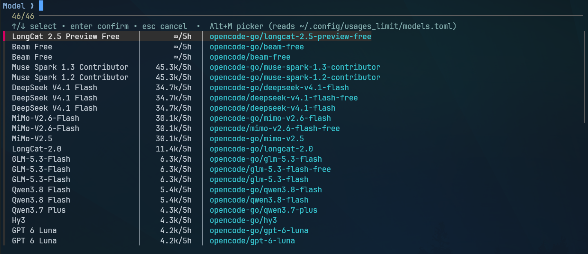

# opencode-go-limits

Scrapes [OpenCode Go](https://opencode.ai/docs/go/) model usage limits
(requests per 5 hours / week / month) into a local TOML snapshot.

The snapshot lives at `~/.config/usages_limit/models.toml`, keyed by date
(keeps the last 3 days). Each model entry carries the display `name` plus the
authoritative `slug` (model ID) for use with `opencode -m opencode-go/<slug>`.

## What this gives you

An `Alt+M` model picker (reads `~/.config/usages_limit/models.toml`) that
lists every Go-plan model with its 5h request budget and full
`opencode-go/<slug>` ID, sorted highest-limit first — pick the strongest
model you can afford before hitting a cap.

### Set up Alt+M (zsh)

This repo only writes the TOML. The picker is the companion binary
[`opencode-model-picker`](https://github.com/roquib/opencode-model-picker)
plus a ZLE widget:

```bash
# 1. Picker binary reads the TOML via fzf — install it first
#    (requires fzf: https://github.com/junegunn/fzf)
~/.local/bin/opencode-model-picker --list   # should print models

# 2. Source the widget (after oh-my-zsh / fzf in ~/.zshrc)
[[ -f "$HOME/dots/zsh/functions/opencode-model.zsh" ]] \
  && source "$HOME/dots/zsh/functions/opencode-model.zsh"

# 3. Reload and use
exec zsh
# Press Alt+M → fzf picker, Enter runs `opencode --model <picked>`
# Or without the keybinding: omodel --exec
```

The widget registers itself with:

```zsh
zle -N _omodel_widget
bindkey '^[m' _omodel_widget
bindkey '\em' _omodel_widget
```

(`^[m` / `\em` is Alt+M. In some terminals Alt+M arrives as `^[m` —
if it does nothing, check `showkey -a` or remap your terminal's
Meta/Alt key.)

Once bound, it looks like this:



## Install

```bash
./install.sh
# verbose output:
./install.sh --verbose
```

This builds the release binary, installs it to `~/.local/bin/opencode-go-limits`,
and adds an hourly cron job (logs to `~/.local/share/opencode-go-limits.log`).

> Requires `~/.local/bin` on your `PATH`. Check with
> `echo $PATH | grep -q "$HOME/.local/bin" && echo OK || echo MISSING`.
> If missing, add it once:
>
> ```bash
> echo 'export PATH="$HOME/.local/bin:$PATH"' >> ~/.bashrc && source ~/.bashrc
> # zsh: echo 'export PATH="$HOME/.local/bin:$PATH"' >> ~/.zshrc && source ~/.zshrc
> ```

## Usage

```bash
opencode-go-limits --once   # single scrape, then exit
opencode-go-limits          # scrape every hour (loop)
```

Example output file (`~/.config/usages_limit/models.toml`):

```toml
["2026-10-25"]
[[models."2026-10-25"]]
name = "Muse Spark 1.3 Contributor"
slug = "muse-spark-1.3-contributor"
requests_per_5h = "Unlimited"
requests_per_week = 100
requests_per_month = "Unlimited"
```

`Unlimited` windows are stored as the string `"Unlimited"`; limited windows
are integers. Promo cells with two figures (base + boost) record the max.

## Development

```bash
cargo test
cargo clippy -- -D warnings
cargo fmt --check
cargo build --release
```

## How it works

1. Fetches `https://opencode.ai/docs/go/`.
2. Reads the Endpoints table (`Model | Model ID | ...`) for authoritative slugs.
3. Reads the `go`-plan requests table under `#go-requests-panel-go`
   (falls back to any `Model | Requests per 5 hours | ...` table).
4. Sorts models by 5h limit descending (`Unlimited` first) and writes TOML.

## License

MIT — see [LICENSE](LICENSE).
